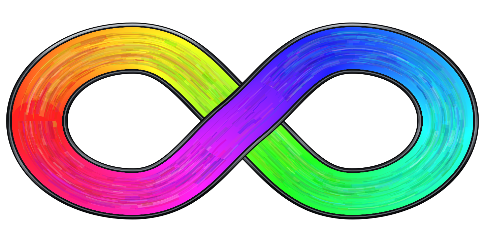

# InfiniForge

**Independent Android apps, connected by reusable libraries and open platform interfaces.**

InfiniForge is an ecosystem of focused applications and shared libraries. Each app is its own project: it owns its build, data, lifecycle, and user experience, and can be built and installed independently. Apps can work together through Android intents, Storage Access Framework (SAF), content URIs, and other documented public interfaces.

InfiniFolder is the ecosystem’s central file manager and advanced storage layer. It adds powerful file access for the other apps when installed, while each companion app keeps its own standalone workflows.

## Applications

### Available projects

- [InfiniFolder](https://github.com/infiniforge/infinifolder) — file manager and advanced storage layer.
- [InfiniMedia](https://github.com/infiniforge/infinimedia) — player for supported audio, video, and image formats.
- [InfiniScribe](https://github.com/infiniforge/infiniscribe) — document viewer; development and format coverage are still in progress.
- [Infinikey](https://github.com/infiniforge/infinikey-ime) — programmable Android keyboard input method.
- [InfiniMesh](https://github.com/infiniforge/infinimesh) — read-only 3D model viewer with STL shading and G-code simulation.

### Planned projects

- [InfiniCanvas](https://github.com/infiniforge/infinicanvas) — image editor.
- [InfiniWave](https://github.com/infiniforge/infiniwave) — audio editor, with Audacity as a reference.
- [InfiniTrack](https://github.com/infiniforge/infinitrack) — music tracker and digital audio workstation.
- [InfiniLaunch](https://github.com/infiniforge/infinilaunch) — application launcher and launch functions.
- [InfiniPlay](https://github.com/infiniforge/infiniplay) — emulator frontend planned around the Libretro app backend.

Planned projects are early placeholders; their repositories describe the intended direction, not completed features.

## Shared libraries

Applications use the libraries they need through explicit, pinned dependencies. The libraries are maintained separately from the apps and can be developed and built on their own.

- Foundations and interfaces: [libinfinicore](https://github.com/infiniforge/libinfinicore), [libinfiniui](https://github.com/infiniforge/libinfiniui), [libinfinistream](https://github.com/infiniforge/libinfinistream)
- Files and storage: [libinfiniselect](https://github.com/infiniforge/libinfiniselect), [libinfinistore](https://github.com/infiniforge/libinfinistore), [libinfinivault](https://github.com/infiniforge/libinfinivault), [libinfinimeta](https://github.com/infiniforge/libinfinimeta)
- Media and creative formats: [libinfinisound](https://github.com/infiniforge/libinfinisound), [libinfinivideo](https://github.com/infiniforge/libinfinivideo), [libinfiniscribe](https://github.com/infiniforge/libinfiniscribe), [libinfinicanvas](https://github.com/infiniforge/libinfinicanvas), [libinfinemesh](https://github.com/infiniforge/libinfinemesh), [Infini Icon Theme](https://github.com/infiniforge/infini-icon-theme)

## Build and contribute

Build instructions and current capabilities are documented in each application and library repository. Start from the project you want to work on, use its standalone build, and keep cross-project integration on documented library or Android interfaces.

[Browse all InfiniForge repositories](https://github.com/orgs/infiniforge/repositories)
