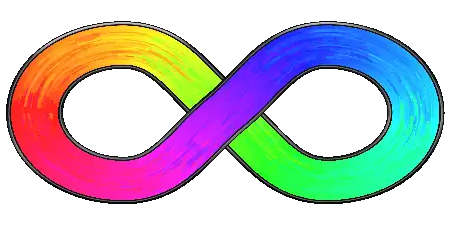

# InfiniForge

**Independent Android apps, connected by reusable libraries and open platform interfaces.**

InfiniForge is an ecosystem of focused open-source applications and shared libraries. Each app is its own project: it owns its build, data, lifecycle, and user experience, and can be built and installed independently. Apps can work together through Android intents, Storage Access Framework (SAF), content URIs, and other documented public interfaces.

InfiniFolder is the ecosystem's central file manager and advanced storage companion. It adds powerful file access for other apps when installed, while each companion app keeps its own standalone workflows.

## Applications

### Active projects

- [InfiniFolder](https://github.com/infiniforge/infinifolder) — file manager and advanced storage, including remote resources, archives, and filesystem images.
- [InfiniMedia](https://github.com/infiniforge/infinimedia) — audio, video, and image player with playlists, visualizations, and effects.
- [InfiniScribe](https://github.com/infiniforge/infiniscribe) — document viewer/editor and ebook reader; supported formats and editing coverage are evolving.
- [Infinikey](https://github.com/infiniforge/infinikey-ime) — programmable Android keyboard input method.
- [InfiniMesh](https://github.com/infiniforge/infinimesh) — 3D model viewer and G-code simulation.
- [InfiniCanvas](https://github.com/infiniforge/infinicanvas) — image editor with layers, indexed palettes, IFF color cycling, and frame-based animation.
- [InfiniWave](https://github.com/infiniforge/infiniwave) — multitrack audio editor with effects and FM/OPL3/SID/CMS sound synthesis.
- [InfiniPlay](https://github.com/infiniforge/infiniplay) — emulator frontend built around in-process Libretro cores, with controller and game-library management.

### Planned projects

- [InfiniTrack](https://github.com/infiniforge/infinitrack) — music tracker, sequencer, and digital audio workstation.
- [InfiniLaunch](https://github.com/infiniforge/infinilaunch) — Android launcher with suite-aware integrations and widgets.

Active projects have standalone builds, but are still under development; check each repository for current functionality, build evidence, and limitations. Planned projects are placeholders rather than completed applications.

## Shared libraries

Applications use the libraries they need through explicit, pinned dependencies. Libraries are maintained separately from apps and own reusable functionality; applications retain their own UI, data, and lifecycle.

- **Foundations and interfaces:** [libinfinicore](https://github.com/infiniforge/libinfinicore), [libinfiniui](https://github.com/infiniforge/libinfiniui), [libinfinistream](https://github.com/infiniforge/libinfinistream)
- **Files and storage:** [libinfiniselect](https://github.com/infiniforge/libinfiniselect), [libinfinistore](https://github.com/infiniforge/libinfinistore), [libinfinivault](https://github.com/infiniforge/libinfinivault), [libinfinimeta](https://github.com/infiniforge/libinfinimeta)
- **Media and creative formats:** [libinfinisound](https://github.com/infiniforge/libinfinisound), [libinfinisynth](https://github.com/infiniforge/libinfinisynth), [libinfinivideo](https://github.com/infiniforge/libinfinivideo), [libinfiniscribe](https://github.com/infiniforge/libinfiniscribe), [libinfinicanvas](https://github.com/infiniforge/libinfinicanvas), [libinfinemesh](https://github.com/infiniforge/libinfinemesh)
- **Visual effects:** [libinfinifx](https://github.com/infiniforge/libinfinifx) — reusable OpenGL ES 3.0 shader graphs and effects, including audio-reactive visualizations, compositing, CRT/LCD presentation filters, rotozoom, and kaleidoscope. InfiniMedia has a host integration; emulator integration in InfiniPlay is a future goal.
- **Visual assets:** [Infini Icon Theme](https://github.com/infiniforge/infini-icon-theme)

The animated logo above is a WebP preview converted from the original palette-cycling `infini.iff`. The source image is preserved in [InfiniMedia](https://github.com/infiniforge/infinimedia/blob/main/infini.iff).

## Build and contribute

Build instructions and current capabilities are documented in each application and library repository. Start from the project you want to work on, use its standalone build, and keep cross-project integration on documented library or Android interfaces.

[Browse all InfiniForge repositories](https://github.com/orgs/infiniforge/repositories)
